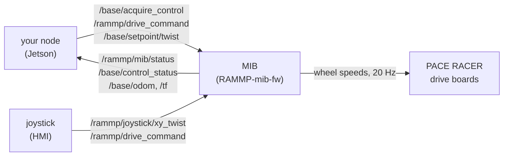
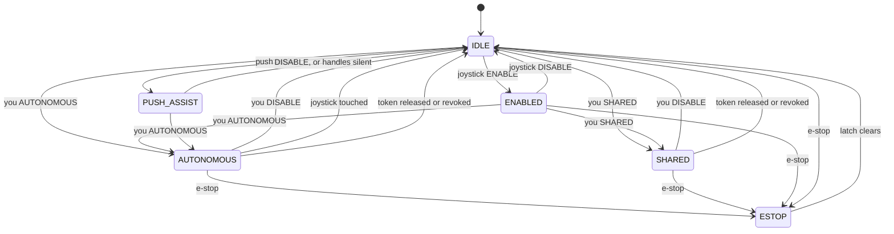

import { Callout } from 'nextra/components'

# Controlling the base

The base is the wheelchair's drive: two drive wheels on PACE RACER motor boards,
commanded by the MIB (MEBot Interface Board), an ESP32-P4 running
[RAMMP-mib-fw](https://github.com/rammp-org/RAMMP-mib-fw). There is no ROS 2 driver
node in between. The MIB speaks RTPS on the chair's Ethernet under ROS 2 topic and
type names, so a ROS 2 node on the Jetson publishes to it and subscribes from it
directly, with the types in `rammp_base_interfaces`.

| | |
| --- | --- |
| Firmware | [rammp-org/RAMMP-mib-fw](https://github.com/rammp-org/RAMMP-mib-fw) |
| Types | [`rammp_base_interfaces`](https://github.com/rammp-org/rammp-interfaces-ros2/tree/main/rammp_base_interfaces) and [`rammp_common_interfaces`](https://github.com/rammp-org/rammp-interfaces-ros2/tree/main/rammp_common_interfaces), v2.0.0, built into `rammp-base` 2.0.0-jp6 |
| Wire | Raw RTPS (XCDR1), the encoding ROS 2 speaks. No bridge. |
| Address | `192.168.4.1` on the chair's Ethernet. The MIB runs the DHCP server. |

<Callout>
  This page describes RAMMP-mib-fw `main` as of 2026-11-07, with the base's token
  arbitration wired in.
</Callout>

## What you are talking to



Two things can ask the base to move: the user's joystick, and your node. The MIB
decides which one it listens to, and reports its decision in `MibStatus`. The
joystick must keep driving the chair with no Jetson attached, so your node never
sits between them: you ask the MIB for a mode, and the MIB tells you whether you
have it.

Among ROS 2 nodes, a second gate decides *which* node drives: the token. You
acquire the base through `/base/acquire_control`, receive a token, and put it on
every `TwistSetpoint`. A setpoint without the live token is dropped. The joystick
carries no token and is never arbitrated; the token is only ever about nodes on
the Jetson.

## Topics

| Topic | Type | Direction | QoS | Rate |
| --- | --- | --- | --- | --- |
| `/rammp/mib/status` | `rammp_base_interfaces/MibStatus` | MIB → you | best-effort | every 500 ms, changed or not |
| `/rammp/drive_command` | `rammp_base_interfaces/DriveCommand` | you → MIB | best-effort | on change |
| `/base/setpoint/twist` | `rammp_base_interfaces/TwistSetpoint` | you → MIB | best-effort, latest wins | at least every 300 ms while driving |
| `/rammp/joystick/xy_twist` | `rammp_peripheral_interfaces/XYTwist` | joystick → anyone | best-effort | continuous |
| `/base/odom` | `nav_msgs/Odometry` | MIB → you | reliable | 20 Hz |
| `/tf` | `tf2_msgs/TFMessage`, `odom` → `base_link` | MIB → you | reliable | 20 Hz |
| `/base/control_status` | `rammp_common_interfaces/ControlStatus` | MIB → you | reliable | on change, and every 1 s |
| `/estop` | `rammp_common_interfaces/EStop` | any ↔ MIB | best-effort | every 100 ms per node |

| Service | Type | Who calls it |
| --- | --- | --- |
| `/base/acquire_control` | `rammp_common_interfaces/AcquireControl` | your node, before it drives |
| `/base/release_control` | `rammp_common_interfaces/ReleaseControl` | your node, when it is done |
| `/base/revoke_control` | `rammp_common_interfaces/RevokeControl` | an operator tool, to take the base from a stuck node |

<Callout type="warning">
  The MIB's status and commands are **best-effort**. A reliable subscriber never
  matches a best-effort publisher, so it gets nothing and looks broken. On the
  command line that means
  `ros2 topic echo --qos-reliability best_effort /rammp/mib/status`, and in code it
  means a best-effort QoS profile on every subscription and publisher to the MIB.
</Callout>

The `.msg` files mirror the MIB's own structs in
[rammp-rtps](https://github.com/rammp-org/rammp-rtps), field for field and in wire
order. They are not the source of truth, so never reorder, insert or retype a field.

## The MIB's states

`MibStatus.system_state` is the one value that says who is driving. Everything
below is a transition between these states.

| State | Who drives | What it accepts |
| --- | --- | --- |
| `INITIALIZING` (0) | nobody | nothing; bringing up the board |
| `IDLE` (1) | nobody | `ENABLE`, `AUTONOMOUS`, `SHARED`, push assist. Seat control is available. |
| `ENABLED` (2) | the joystick | `ENABLE` (profile change), `DISABLE`, `AUTONOMOUS`, `SHARED` |
| `ERROR` (3) | nobody | nothing; `error_message` says why |
| `AUTONOMOUS` (4) | the token holder's `TwistSetpoint` | `DISABLE`. A joystick touch ends it, as does releasing or revoking the token. |
| `SHARED` (5) | the token holder's `TwistSetpoint` | `DISABLE`, or releasing or revoking the token. A joystick touch does not interrupt; your node reads the stick instead. |
| `ESTOP` (6) | nobody | nothing; returns to `IDLE` on its own once the latch clears |
| `PUSH_ASSIST` (7) | an assistant, from the push handle | `DISABLE`, `AUTONOMOUS`, `SHARED` |



`ENABLED` is the joystick's state and only the joystick asks for it. Your node asks
for `AUTONOMOUS` or `SHARED`, and ends them with `DISABLE`. Every exit from autonomy
lands in `IDLE`, never back in `ENABLED`: the user re-enables driving from the
joystick themselves. Every exit also drops the token: the next session starts with
a new acquire.

## Taking the base: `/base/acquire_control`

The state says the MIB is listening to a ROS 2 node. The token says which one. Before
your setpoints can move anything you need both, and the token comes first.

Call `/base/acquire_control` (`rammp_common_interfaces/srv/AcquireControl`) with an
`owner_id` that names your node and the request `token` left all-zero. The MIB mints
a random 128-bit token and returns it with `accepted: true` and a `generation`
number. Keep the token and put it on every `TwistSetpoint`.

```sh
ros2 service call /base/acquire_control rammp_common_interfaces/srv/AcquireControl \
  "{owner_id: my_node}"

ros2 topic echo /base/control_status
```

It is the arm's protocol, served by the MIB under `/base`; the
[Common interfaces](/interfaces/common#arbitration) page has the types. What matters
for the base:

- **One owner at a time, and acquiring seizes.** If another node holds the base,
  your acquire still succeeds: the chair stops once, the previous holder's token
  stops matching, and the state stays, so your setpoints drive from here. The
  dispossessed node learns of it from `/base/control_status`: `owned` stays true but
  `owner_id` is not it, and `generation` has bumped.
- **A grant alone does not drive.** In `IDLE` your tokened setpoints are dropped
  like any other. Acquire, then ask for `AUTONOMOUS` or `SHARED`. The other order
  also works, since the `DriveCommand` carries no token, but your setpoints are
  refused until the acquire lands.
- **Release when you are done.** `/base/release_control` with your token. From
  `AUTONOMOUS` or `SHARED` it stops the chair and drops to `IDLE` with no owner, so
  it is also an exit; see [Leaving](#leaving-autonomous-or-shared).
- **Revoke is the operator's.** `/base/revoke_control` takes the base from whoever
  holds it, with no token, for a node that has crashed holding the grant. It stops
  the chair and drops autonomy to `IDLE`, the same as a release.
- **You lose the grant whenever autonomy ends.** A joystick touch, your `DISABLE`
  and the e-stop all revoke it, so a node that was dispossessed cannot resume
  driving on the next session with its old token. Acquire again each time.
- **Acquire is refused while e-stopped.** The latch clears to *no owner*, never
  back to you.

`/base/control_status` (`rammp_common_interfaces/ControlStatus`) is reliable and
is resent every second whether or not it changed, so a plain `ros2 topic echo`
works and a late subscriber catches up within a second. `rejected_count` rising
while you publish means your token is not the live one. `arbitration_enabled` is
`true` on the chair's firmware; a bring-up build with it `false` admits every
setpoint but still tracks and reports ownership.

## Entering AUTONOMOUS or SHARED

Publish one `DriveCommand` on `/rammp/drive_command`:

| Field | Value |
| --- | --- |
| `request` | `REQUEST_AUTONOMOUS` (2) or `REQUEST_SHARED` (3) |
| `profile` | `PROFILE_LOW` (0), `PROFILE_NORMAL` (1) or `PROFILE_HIGH` (2): the speed and acceleration caps your setpoints are clamped to. See [Profiles](#profiles). |
| `push_assist` | `false` |

The MIB accepts the request from `IDLE`, `ENABLED` and `PUSH_ASSIST`, and refuses it
from everything else, including from `AUTONOMOUS` and `SHARED` themselves. To switch
between the two, send `DISABLE` first, wait for `IDLE`, then ask again.

On entry the MIB stops the drive, applies the profile, and waits for the token
holder's first `TwistSetpoint`. If the user was driving, the chair decelerates to a
stop before you get it. The request itself carries no token, and any node may send
it; holding the token is what makes the state yours.

**The answer is `MibStatus.system_state`, not an acknowledgement.** The link is
best-effort, so a request may be lost: repeat it, a few times a second, until the
status shows the state you asked for, then stop. The status ticks every 500 ms, so
expect the answer within about a second.

```sh
# Ask for AUTONOMOUS with the NORMAL profile, three times at 2 Hz.
ros2 topic pub -r 2 -t 3 --qos-reliability best_effort /rammp/drive_command \
  rammp_base_interfaces/msg/DriveCommand "{request: 2, profile: 1, push_assist: false}"

ros2 topic echo --qos-reliability best_effort --field system_state /rammp/mib/status
```

<Callout type="warning">
  Once the status shows your state, **stop repeating the request.** A later change
  of state is the MIB's decision, not a lost packet: a joystick touch ended
  `AUTONOMOUS` because the user wanted the chair back. Asking again at once would
  take it from them. Ask again only when you have a new reason of your own.
</Callout>

The request constants and the status constants are different enums with different
numbers. Compare each against its own message:

| You send `DriveCommand.request` | You expect `MibStatus.system_state` |
| --- | --- |
| `REQUEST_AUTONOMOUS` = 2 | `SYSTEM_STATE_AUTONOMOUS` = 4 |
| `REQUEST_SHARED` = 3 | `SYSTEM_STATE_SHARED` = 5 |
| `REQUEST_DISABLE` = 0 | `SYSTEM_STATE_IDLE` = 1 |

### AUTONOMOUS or SHARED: which one to ask for

In both states your `TwistSetpoint` is the only thing driving the chair. They
differ in what the user's joystick means while you drive:

- **`AUTONOMOUS`: the joystick is the user's override.** Any stick deflection or
  button press ends it: the chair stops and the MIB goes to `IDLE`. Ask for this
  when your node drives on its own, from a plan the user is not part of, so that
  touching the stick always wins.
- **`SHARED`: the joystick is yours.** The MIB does not read the stick for driving
  and a touch does not interrupt you. The stick is still broadcast on
  `/rammp/joystick/xy_twist`, so your node reads it there and decides what it
  means: steering the base, steering the arm, or switching between the two as the
  task goes on. Whatever you decide, the base only ever sees your `TwistSetpoint`.
  Ask for this when the user drives *through* your node.

So the choice is about who interprets the stick. In `AUTONOMOUS` the MIB does, and
its one interpretation is "stop". In `SHARED` your node does, which is what makes
it possible to use one joystick for the arm and the base. In `SHARED` nothing on
the chair stops for a stick touch, so your node is the user's way out: if the user
steers the base through you, you convert the stick into setpoints; if they steer
something else, you keep the base still, or send `DISABLE`.

## Driving: `TwistSetpoint`

Publish `rammp_base_interfaces/TwistSetpoint` on `/base/setpoint/twist`, best-effort.

| Field | Meaning |
| --- | --- |
| `twist.linear.x` | forward velocity, m/s (negative backs up) |
| `twist.angular.z` | yaw rate, rad/s, positive counter-clockwise from above (a left turn) |
| `twist.linear.y`, everything else | ignored: a differential drive cannot move sideways |
| `token` | `uint8[16]`, the one `/base/acquire_control` returned, on every setpoint. A setpoint with any other token is dropped and counted in `ControlStatus.rejected_count`. See [Taking the base](#taking-the-base-baseacquire_control). |

The frame is `base_link` ([REP 103](https://www.ros.org/reps/rep-0103.html): x forward,
y left, z up). The velocity is absolute, not a delta, and latest wins: a dropped
setpoint is correct behaviour, which is why the topic is best-effort.

**It only drives in `AUTONOMOUS` or `SHARED`, with the live token.** In any other
state the MIB drops the setpoint silently. A setpoint whose token is not the live
grant is dropped too, in any state, and counted. A setpoint with a NaN or infinite
value is dropped in any state.

**Keep publishing.** The MIB stops the chair 300 ms after the last *admitted*
setpoint, stays in the same state, and drives again on the next one. A refused
setpoint does not refresh that deadline, so a node whose token has gone stale sees
the chair stop within 300 ms rather than at once. So a dead publisher stops
the chair, but a slow one makes it stutter. Publish at 10 Hz at the very least;
20 Hz is comfortable. The MIB commands the wheels at 20 Hz, so faster buys nothing.

**To stop, send zeros.** The MIB's trajectory planner decelerates to the target at
the profile's acceleration limit, so a zero setpoint is a controlled stop. Going
silent also stops the chair, 300 ms later, and is what happens when your node
crashes; do not rely on it as your normal stop.

### Profiles

Your setpoints are clamped to the profile you asked for in the `DriveCommand`. A
setpoint over the cap is scaled down, linear and angular together, so the turn
radius you asked for is kept. Changes of velocity are smoothed by the planner's
acceleration limits. A bad setpoint cannot command a jerk or exceed what the chair
allows a human.

| Profile | Max linear | Max angular | Max linear accel | Max angular accel |
| --- | --- | --- | --- | --- |
| `LOW` (0) | 0.35 m/s | 1.0 rad/s | 0.5 m/s² | 1.0 rad/s² |
| `NORMAL` (1) | 0.75 m/s | 2.0 rad/s | 1.0 m/s² | 2.0 rad/s² |
| `HIGH` (2) | 1.0 m/s | 3.14 rad/s | 2.0 m/s² | 4.0 rad/s² |

`MibStatus.active_profile` reports the profile in force. To change it while in
`AUTONOMOUS` or `SHARED`, leave with `DISABLE` and ask again with the new profile.

### Reading back what happened

- `MibStatus.speed` is the chair's ground speed in m/s, unsigned. It is the average
  of the wheel speeds the MIB is commanding, not a measurement.
- `/base/odom` is the measured wheel odometry. See [Odometry](#odometry).

## Leaving AUTONOMOUS or SHARED

There are six ways out. All of them stop the chair and land in `IDLE`, all of them
drop the token, and none of them resumes anything: driving has to be re-enabled from
the joystick, and you have to acquire and ask for autonomy again.

| Exit | How you see it |
| --- | --- |
| **You send `DISABLE`.** `DriveCommand` with `request: REQUEST_DISABLE`, `push_assist: false`. Repeat until `system_state` shows `IDLE`. | `IDLE`; `control_status` shows `owned: false` |
| **You release the token.** `/base/release_control` with your token. One reliable call, no repeat. | `IDLE`, `owned: false` |
| **An operator revokes the token.** `/base/revoke_control`, from a tool, with no token. | `IDLE`, `owned: false`, unasked |
| **The user touches the joystick** (`AUTONOMOUS` only). Any deflection or button. | `IDLE`, `owned: false`, unasked. Do not re-request automatically. |
| **The e-stop engages**, from any node or the hardware chain. | `ESTOP` with `estopped: true`, then `IDLE` with no owner once the latch clears, at the earliest 3 s later. `error_message` names the cause. |
| **A fault.** | `ERROR`. Not operational; `error_message` and `error_footer` say what to do. |

Another node acquiring the base is **not** an exit, but it is the end of your
driving: the chair stops once, the state stays, and your token no longer matches.
Watch `control_status.generation`.

A lapse of your setpoints is **not** an exit: the chair stops, the state stays, and
the next setpoint drives again.

```sh
ros2 topic pub -r 2 -t 3 --qos-reliability best_effort /rammp/drive_command \
  rammp_base_interfaces/msg/DriveCommand "{request: 0, profile: 1, push_assist: false}"
```

Send `DISABLE` on your way out even if you believe the MIB has already left: from
`IDLE` it is a harmless repeat, and from `AUTONOMOUS` it is the stop you meant. A
release does the same with one reliable call and also hands the base back
explicitly; the example below does both.

## A whole session

```mermaid
sequenceDiagram
  participant N as your node
  participant M as MIB
  participant J as joystick
  N->>M: acquire_control(owner_id)
  M-->>N: accepted, token, generation
  N->>M: DriveCommand AUTONOMOUS, NORMAL (repeat until answered)
  M-->>N: MibStatus system_state = AUTONOMOUS
  loop 20 Hz
    N->>M: TwistSetpoint (linear.x, angular.z, token)
  end
  alt you are done
    N->>M: TwistSetpoint zeros
    N->>M: release_control(token)
    M-->>N: MibStatus system_state = IDLE, control_status owned = false
  else the user wants the chair
    J->>M: XYTwist, stick deflected
    M-->>N: MibStatus system_state = IDLE, control_status owned = false
    Note over N: stop publishing; do not re-request
  end
```

A minimal rclpy client. Every endpoint is created once, at startup, the
`DriveCommand` is repeated only until the status answers, and the token from the
acquire goes on every setpoint. Note the token conversion: rclpy hands back a
`uint8[16]` as a numpy array, and the outgoing message refuses numpy scalars.

```python
import rclpy
from rclpy.node import Node
from rclpy.qos import HistoryPolicy, QoSProfile, ReliabilityPolicy

from rammp_base_interfaces.msg import DriveCommand, MibStatus, TwistSetpoint
from rammp_common_interfaces.msg import ControlStatus
from rammp_common_interfaces.srv import AcquireControl, ReleaseControl

# What the MIB advertises. A reliable subscriber would never match.
BEST_EFFORT = QoSProfile(
    reliability=ReliabilityPolicy.BEST_EFFORT, history=HistoryPolicy.KEEP_LAST, depth=1
)


class BaseClient(Node):
    def __init__(self):
        super().__init__("base_client")
        self.state = None
        self.wanted = None
        self.token = None  # held only while we own the base
        self.generation = None
        self.create_subscription(MibStatus, "/rammp/mib/status", self.on_status, BEST_EFFORT)
        self.create_subscription(ControlStatus, "/base/control_status", self.on_control, 10)
        self.drive_pub = self.create_publisher(DriveCommand, "/rammp/drive_command", BEST_EFFORT)
        self.twist_pub = self.create_publisher(TwistSetpoint, "/base/setpoint/twist", BEST_EFFORT)
        self.acquire_cli = self.create_client(AcquireControl, "/base/acquire_control")
        self.release_cli = self.create_client(ReleaseControl, "/base/release_control")
        self.create_timer(0.5, self.repeat_request)  # the link is best-effort
        self.create_timer(0.05, self.send_setpoint)  # 20 Hz, well inside the 300 ms lapse
        self.linear, self.angular = 0.0, 0.0

    def on_status(self, msg: MibStatus):
        if msg.system_state != self.state:
            self.get_logger().info(f"MIB state {self.state} -> {msg.system_state}")
        self.state = msg.system_state

    def on_control(self, msg: ControlStatus):
        if self.token is not None and msg.generation != self.generation:
            # Someone else acquired, an operator revoked, or autonomy ended: our token is dead.
            self.get_logger().warn(f"lost the base to {msg.owner_id!r}" if msg.owned else "base released")
            self.token = None

    def acquire(self, timeout_sec: float = 5.0) -> bool:
        """Take the base. Seizes if another node holds it; refused only while e-stopped."""
        if not self.acquire_cli.wait_for_service(timeout_sec):
            return False
        future = self.acquire_cli.call_async(AcquireControl.Request(owner_id=self.get_name()))
        rclpy.spin_until_future_complete(self, future, timeout_sec=timeout_sec)
        result = future.result()
        if result is None or not result.accepted:
            return False
        self.token = [int(b) for b in result.token]  # numpy uint8 -> plain ints
        self.generation = result.generation
        return True

    def release(self):
        if self.token is None:
            return
        future = self.release_cli.call_async(ReleaseControl.Request(token=self.token))
        rclpy.spin_until_future_complete(self, future, timeout_sec=2.0)
        self.token = None

    def request(self, request: int, profile: int = DriveCommand.PROFILE_NORMAL):
        """Ask once; repeat_request() keeps asking until MibStatus answers."""
        self.wanted = (request, profile)

    def repeat_request(self):
        if self.wanted is None:
            return
        request, profile = self.wanted
        answered = {
            DriveCommand.REQUEST_AUTONOMOUS: MibStatus.SYSTEM_STATE_AUTONOMOUS,
            DriveCommand.REQUEST_SHARED: MibStatus.SYSTEM_STATE_SHARED,
            DriveCommand.REQUEST_DISABLE: MibStatus.SYSTEM_STATE_IDLE,
        }[request]
        if self.state == answered:
            self.wanted = None  # done: a later change of state is the MIB's decision
            return
        self.drive_pub.publish(DriveCommand(request=request, profile=profile, push_assist=False))

    def send_setpoint(self):
        if self.token is None:
            return  # not ours to drive
        if self.state not in (MibStatus.SYSTEM_STATE_AUTONOMOUS, MibStatus.SYSTEM_STATE_SHARED):
            return  # dropped by the MIB anyway
        msg = TwistSetpoint()
        msg.twist.linear.x = self.linear
        msg.twist.angular.z = self.angular
        msg.token = self.token
        self.twist_pub.publish(msg)


def main():
    rclpy.init()
    node = BaseClient()
    if not node.acquire():
        node.get_logger().error("could not acquire the base")
        rclpy.shutdown()
        return
    node.request(DriveCommand.REQUEST_AUTONOMOUS)
    node.linear, node.angular = 0.2, 0.0  # creep forward at 0.2 m/s
    try:
        rclpy.spin(node)
    finally:
        node.linear, node.angular = 0.0, 0.0
        node.request(DriveCommand.REQUEST_DISABLE)
        for _ in range(4):
            rclpy.spin_once(node, timeout_sec=0.5)
        node.release()  # a no-op if the DISABLE already revoked it
        rclpy.shutdown()
```

## Reading the base's state: `MibStatus`

Published on `/rammp/mib/status` every 500 ms whether or not anything changed, so a
subscriber that starts late catches up on the next tick.

| Field | Type | Meaning |
| --- | --- | --- |
| `system_state` | `uint8` | One of `SYSTEM_STATE_*`. See [The MIB's states](#the-mibs-states). |
| `active_profile` | `uint8` | One of `PROFILE_*`: what the last granted `DriveCommand.profile` asked for |
| `current_seat_state` | `SeatState` | Seat tilt (degrees), elevation and translation (millimetres) |
| `error_message` | `string` | Human-readable; `"No error"` when none. In `ESTOP`, the latch's cause. |
| `epoch_s` | `int64` | The MIB's clock, Unix seconds. `0` until it has synced to the Jetson over NTP. |
| `speed` | `float32` | Ground speed, m/s, unsigned, from the commanded wheel speeds |
| `utc_offset_min` | `int16` | Minutes east of UTC, to turn `epoch_s` into wall time |
| `seq` | `uint8` | +1 per message, wraps. A gap is a dropped sample. |
| `status_text` | `string` | Optional wording for the state label; empty means the state's name |
| `error_footer` | `string` | What to do about `error_message` |

`SeatState` has no topic of its own; it arrives inside `MibStatus`. Seat commands
are the joystick's and are not on a ROS 2 facing topic today.

## Odometry

The MIB integrates the drive wheels' encoders and publishes
`nav_msgs/Odometry` on `/base/odom` at 20 Hz, reliable, with the pose in `odom` and
the twist in `base_link` ([REP 105](https://www.ros.org/reps/rep-0105.html)). It also
publishes the `odom` → `base_link` transform on `/tf`, because it is the only
odometry source on the chair today. Once a filter on the Jetson owns that
transform, the MIB's `/tf` publisher goes away: two publishers of one transform
fight.

The wheels are 0.355 m in diameter, 0.6096 m apart. A planar base cannot observe
z, roll or pitch, so those covariances are large; x, y and yaw are small.

## The e-stop

The MIB owns the robot-wide e-stop latch. Any node, yours included, may engage it
by publishing `rammp_common_interfaces/EStop` with `state: STATE_ENGAGED` on
`/estop`; the chair stops at once and the MIB goes to `ESTOP`. Only the MIB clears
the latch, through its handshake with every engaged source, and it returns to
`IDLE` by itself when that succeeds. Your `TwistSetpoint` is ignored throughout.
The e-stop also latches the arbiter: `control_status` shows `estopped: true`, the
grant is dropped, and an acquire is refused until the latch clears, to no owner.
Acquire again afterwards.

A node that engages must keep publishing `ENGAGED`, every 100 ms, until it accepts
the MIB's clear attempt; a plain `NOT_ENGAGED` from it is a heartbeat, not a clear.
The full rules, including the heartbeat and deadman, are in the comments of the
`EStop` type and in the
[arm's description of the e-stop](/kinova-gen3-ros2/interface#the-e-stop), which
obeys the same protocol.

## Reaching the MIB from ROS 2

The MIB is `192.168.4.1` on the chair's Ethernet and runs the DHCP server for it.
Everything on this page works from a container built on `rammp-base` with no extra
configuration, provided the container runs with `--network host`. A few things to
check when `ros2 topic list` does not show `/rammp/mib/status`:

- **Discovery is multicast.** The MIB announces itself on `239.255.0.1` every 2 s. A
  switch doing IGMP snooping without a querier drops that group, and the host never
  discovers the MIB, though the MIB discovers the host. Cable the host directly to
  rule the switch out.
- **DDS on the right interface.** On a host with several interfaces (Wi-Fi, a VPN),
  bind the RMW to the one on the MIB's subnet. The base image's Cyclone DDS
  configuration is at `/etc/cyclonedds/config.xml`; override it with
  `CYCLONEDDS_URI`.
- **One RMW everywhere.** `RMW_IMPLEMENTATION` must be the same in every shell and
  container, or nodes on the Jetson cannot see each other. The MIB itself speaks
  plain RTPS and does not care. See the arm's
  [troubleshooting page](/kinova-gen3-ros2/troubleshooting) for what the mismatch
  looks like.
- **Match the QoS.** Best-effort on everything to and from the MIB except `/base/odom`,
  `/tf` and `/base/control_status`, which are reliable, and the three services, which
  are reliable as all services are.
- **Create your endpoints once.** On the bench, a ROS 2 node that created and
  destroyed subscriptions to the MIB in a loop had every few of them never match. A
  client that makes its publishers and subscriptions at startup, as the examples
  here do, is unaffected. Avoid `ros2 topic pub` in a loop for anything but a
  one-off test.

## What is not there yet

- **`PoseSetpoint`.** The type exists in `rammp_base_interfaces` (a target pose in
  `odom`), but nothing on the MIB reads it.
- **Seat control from ROS 2.** Seat commands are the joystick's RTPS type and have
  no ROS 2 facing topic.
- **Firmware-side documentation.** How the MIB, the joystick and the motor boards
  talk to each other over RTPS is documented in the
  [rammp-rtps](https://github.com/rammp-org/rammp-rtps) and
  [RAMMP-mib-fw](https://github.com/rammp-org/RAMMP-mib-fw) repos, not here.
